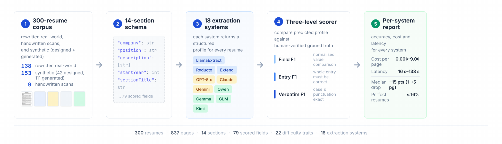

# ResumeBench

[](https://resumebench.ai)
[](https://huggingface.co/datasets/Careerflow/ResumeBench)
[](LICENSE)

**ResumeBench** is a benchmark for **structured extraction** from resume PDFs. Given a resume and a 14-section JSON Schema, how accurately can a system return the structured data? Every field is compared against human-corrected ground truth. Scoring is deterministic with no LLM judge.

Resume parsers drive job matching, candidate screening, and career tools, so extraction errors propagate. ResumeBench measures extraction accuracy at the field level and penalizes both omissions and hallucinations.

<p align="center">
  
</p>

## Leaderboard

[Live leaderboard at resumebench.ai](https://resumebench.ai/leaderboard) · [Dataset on HuggingFace](https://huggingface.co/datasets/Careerflow/ResumeBench)

300 curated resumes, 18 systems. Every system receives the identical PDF, the same 14-section JSON Schema, and the same extraction prompt. Document APIs ingest the schema natively; vision LLMs receive the rendered pages with the prompt. Scoring is deterministic.

<details>
<summary><strong>Metric details</strong></summary>

- **F1:** F1 of extracted values, macro-averaged across sections per document, then averaged across documents. Strings are compared after whitespace collapsing. Typographic variants (smart quotes, curly dashes, soft hyphens) are folded to ASCII equivalents.
- **Cost/page:** USD per page at each provider's official public pricing.
- **Latency:** Wall-clock seconds per resume (median).
- **Type:** API = document extraction service (ingests schema natively); LLM = vision language model (receives rendered pages + prompt).

Failed and missing documents score zero (not dropped), so a system can't boost its average by erroring on hard ones.

</details>

Scores are percentages, costs are USD. Best in each column is **bold**.

| Rank | System | Type | F1 | Cost/page | Latency |
|---:|---|---|---:|---:|---:|
| 1 | **LlamaParse Extract Agentic Plus** | API | **87.1572** | $0.054 | 69.7s |
| 2 | Reducto Deep Extract | API | 85.5526 | $0.040 | 64.8s |
| 3 | LlamaParse Extract Agentic | API | 85.5463 | $0.023 | 54.6s |
| 4 | Claude Opus 4.8 | LLM | 85.5052 | $0.090 | 31.3s |
| 5 | Gemini 3.5 Flash | LLM | 85.4518 | $0.035 | 42.8s |

Top 5 of 18 ranked systems. Full leaderboard with per-section breakdowns and difficulty splits at [resumebench.ai](https://resumebench.ai). All scores also available on [HuggingFace](https://huggingface.co/datasets/Careerflow/ResumeBench).

## Quick Start

**Prerequisites:** Create a `.env` file with the API key for the system you want to evaluate (see [Configuration](#configuration)).

```bash
# Clone the repo
git clone https://github.com/careerflow/ResumeBench.git
cd ResumeBench

# Install from a checkout (provider SDKs are optional extras)
pip install -e ".[dev]"                    # core + dev tools
pip install -e ".[dev,openai]"             # + OpenAI SDK
pip install -e ".[dev,runners]"            # + all provider SDKs

# Download the public dataset (20 resumes) from Hugging Face
resume-bench download

# Quick test run (5 resumes)
resume-bench run openai_gpt-5.6-sol_text --split mini --limit 5

# Full public evaluation (20 resumes)
resume-bench run openai_gpt-5.6-sol_text --split test

# Grade results
resume-bench grade openai_gpt-5.6-sol_text --split test

# View leaderboard across all graded pipelines
resume-bench leaderboard --split test
```

> [!NOTE]
> `resume-bench download` downloads the **20 public test resumes** from Hugging Face. The full benchmark (300 curated resumes) is evaluated at [resumebench.ai](https://resumebench.ai); to access the remaining 280 documents, [request access](https://www.resumebench.ai/resumes?request=1).

> [!WARNING]
> Running a pipeline calls a metered API. Start with `--split mini --limit 5` to verify your setup before a full run. Cost per page ranges from 0.1¢ to 9¢ depending on the provider.

## Dataset

The dataset is hosted on Hugging Face: [`Careerflow/ResumeBench`](https://huggingface.co/datasets/Careerflow/ResumeBench).

| Split | Documents | Purpose |
|---|---:|---|
| `test` | 20 | Public evaluation set (representative subset of the full 300) |
| `mini` | 5 | Quick smoke test (subset of test) |

```bash
resume-bench download              # downloads both splits
resume-bench download --split test # test split only
resume-bench status                # check readiness and show summary statistics
```

The full benchmark covers 300 curated resumes (837 pages) across real-world anonymized resumes, handwritten resumes, and expert-built resumes with varied templates and parsing challenges. Full results at [resumebench.ai](https://resumebench.ai); to access the remaining 280 documents, [request access](https://www.resumebench.ai/resumes?request=1).

## Scoring

`resume-bench grade` uses the v5 scorer by default (`src/resume_bench/grading/canonical.py`): differences in
presentation only, such as "Bachelor" vs "Bachelor's" or ALL-CAPS styling, are not counted as errors. The leaderboard
above and the rules below are from the original scorer; `--scorer strict` scores outputs with it.

Original scorer rules (per-field, identity-gated matching):

| Rule | Effect |
|---|---|
| **Per-field units** | Each field in a matched entity is scored independently. Description bullets are compared positionally (bullet[0] vs bullet[0], etc.). |
| **Identity-gated matching** | Entities are matched by identity fields (e.g. company + position + startYear + endYear) using direct greedy matching. All identity fields must match before any other field is scored. Keyword sections (languages, interests, profiles, publications) and skills use Hungarian alignment. |
| **Section-averaged** | F1 is computed per section, then averaged. A missed custom section costs as much as a missed job. |

**Text comparison:** strings are compared after whitespace collapsing. Typographic variants (smart quotes, curly dashes, soft hyphens) are folded to ASCII equivalents. Contacts and locations are compared case-insensitively.

**Failed extractions score 0**, not skipped. A provider that crashes on hard resumes gets penalized, not rewarded with a higher average.

<details>
<summary><strong>How scoring works in detail</strong></summary>

- **Entity alignment.** Structured sections (experience, education, projects, certifications, awards, volunteering, customSections) use **direct greedy matching** on identity fields, e.g. company + position + startYear + endYear for experience. All identity fields must match (gate = 1.0) before the entity pair is scored. Keyword sections (languages, interests, profiles, publications) use **Hungarian alignment** on cell-mismatch cost. Unmatched ground-truth entries count as omissions (lower recall); unmatched predictions count as hallucinations (lower precision).
- **Field comparison.** Within a matched pair, each field is scored independently after normalization. All string fields (short identity strings, text blocks, descriptions) use the same comparison. Description bullet arrays compare positionally (bullet[0] vs bullet[0], etc.) with missing or extra bullets scoring 0.
- **Normalization.** Strings are compared after whitespace collapsing. Typographic variants (smart quotes `""''`, curly dashes `—`, soft hyphens) are folded to ASCII equivalents. Contacts (email, phone, linkedinUrl) and locations (city, state, country) are compared case-insensitively. No LLM judge, no semantic similarity; matching is deterministic.
- **Aggregation.** Per document: F1 is computed per section and macro-averaged, so a custom section with 2 entries weighs the same as an experience section with 8. Per benchmark: document-level F1 scores are averaged with equal weight regardless of resume length.

</details>

## Schema

The benchmark uses a 14-section resume schema. Each array section is wrapped as `{sectionTitle, items}` and `personalSummary` as `{sectionTitle, text}`.

| Section | Type | Identity Fields |
|---------|------|----------------|
| basics | Singleton (contact info) | — |
| experience | Entity list | company + position + startYear + endYear |
| education | Entity list | institution + studyType + startYear + endYear |
| projects | Entity list | name + startYear + endYear |
| personalSummary | Text | — |
| certifications | Entity list | name + issuer |
| awards | Entity list | title |
| volunteering | Entity list | organization + position + startYear + endYear |
| skills | Flat list (category + skills) | name (Hungarian) |
| publications | Entity list | name (Hungarian) |
| languages | Entity list | name (Hungarian) |
| interests | Entity list | name (Hungarian) |
| profiles | Entity list | network (Hungarian) |
| customSections | Entity list | sectionTitle |

See [`src/resume_bench/schema/resume.json`](src/resume_bench/schema/resume.json) for the full JSON Schema.

## Pipelines

A **pipeline** is an extraction system you want to evaluate. For example:

```bash
# Frontier LLMs
resume-bench run anthropic_claude-opus-4-8_text --split test
resume-bench run openai_gpt-5.6-sol_text --split test
```

Run `resume-bench providers` for the full list — frontier LLMs (Anthropic, OpenAI, Google), document extraction APIs (Reducto, Extend), and open-weight models via OpenRouter (Qwen, GLM, Gemma, DeepSeek).

## Usage

### Running the Benchmark

The `run` command calls the extraction system; `grade` evaluates against ground truth:

```bash
# Evaluate an extraction system on the test split
resume-bench run <pipeline_name> --split test

# Grade results
resume-bench grade <pipeline_name> --split test

# Grade multiple pipelines at once
resume-bench grade <pipeline_a> <pipeline_b> --split test

# View leaderboard across all graded pipelines
resume-bench leaderboard --split test

# Control how many documents are processed in parallel
resume-bench run <pipeline_name> --split test --concurrency 10
```

<details>
<summary><strong>Adding a custom provider</strong></summary>

Create a provider in ~20 lines:

```python
from resume_bench.providers.base import Provider, ExtractionRequest
from resume_bench.providers.registry import register_provider

@register_provider("my_tool")
class MyProvider(Provider):

    def healthcheck(self) -> None:
        pass

    def extract(self, req: ExtractionRequest) -> dict:
        result = call_your_api(req.text, req.extraction_schema)
        return {"parsed": result}

    def to_canonical(self, raw: dict) -> dict:
        return raw["parsed"]
```

Then add a pipeline spec in `src/resume_bench/providers/pipelines.py`:

```python
PipelineSpec(
    pipeline_name="my_tool_v1",
    provider_name="my_tool",
    input_mode=InputMode.TEXT,
)
```

Run it:

```bash
resume-bench run my_tool_v1 --split test
resume-bench grade my_tool_v1 --split test
```

</details>

## Configuration

You only need the API key for the system you want to evaluate. Add it to a `.env` file at the project root:

```bash
# Only add the keys you need. For example, to evaluate GPT-5.6:
RESUME_BENCH_OPENAI_API_KEY=sk-...

# To evaluate Claude:
RESUME_BENCH_ANTHROPIC_API_KEY=sk-ant-...

# To evaluate Google models:
RESUME_BENCH_GOOGLE_API_KEY=...

# To evaluate Reducto:
RESUME_BENCH_REDUCTO_API_KEY=...

# To evaluate Extend (Max Context or Extract):
RESUME_BENCH_EXTEND_API_KEY=sk-...

# For OpenRouter-hosted models (Qwen, GLM, Gemma, DeepSeek, etc.):
RESUME_BENCH_OPENROUTER_API_KEY=sk-or-...
```

No LLM-as-a-judge; scoring is deterministic. Your keys only call the system you're evaluating.

### CLI Reference

| Command | Description |
|---------|-------------|
| `resume-bench download` | Download the dataset from Hugging Face |
| `resume-bench status` | Check dataset readiness and show summary statistics |
| `resume-bench run` | Extract resumes with a pipeline |
| `resume-bench grade` | Grade extraction results against ground truth |
| `resume-bench grade-file` | Grade a JSONL predictions file (bring your own) |
| `resume-bench leaderboard` | Show leaderboard across all graded pipelines |
| `resume-bench providers` | List all available pipelines |
| `resume-bench report` | Show leaderboard report from graded results |
| `resume-bench validate` | Validate a predictions file against the schema |

<details>
<summary><strong>Output structure</strong></summary>

```
output/
└── <pipeline_name>/
    └── <split>/
        ├── *.result.json              # Per-resume extraction results
        ├── _grading_report.json       # Grading summary (F1, precision, recall)
        └── _grading_results.csv       # Per-resume CSV
```

</details>

<details>
<summary><strong>Project structure</strong></summary>

```
src/resume_bench/
├── cli.py                       # Typer CLI entry point
├── settings.py                  # Pydantic settings (env vars)
├── schema/
│   ├── resume.json              # 14-section JSON Schema
│   └── sections.py              # Section specs and identity fields
├── providers/
│   ├── base.py                  # Abstract Provider class
│   ├── registry.py              # Provider registration
│   ├── pipelines.py             # Pipeline definitions (49 specs)
│   └── implementations/        # Per-provider implementations
├── grading/
│   ├── grader.py                # Grade orchestration
│   ├── strict.py                # Scoring engine (identity-gated matching)
│   └── text.py                  # String normalization and comparison
└── data/
    └── download.py              # HuggingFace dataset download
```

</details>

## Citation

```bibtex
@misc{kohli2026resumebench,
  title     = {ResumeBench: A Benchmark for Structured Resume Extraction},
  author    = {Puneet Kohli and Shiv Awasthi and Jeffy Sam},
  year      = {2026},
  url       = {https://resumebench.ai}
}
```

## Links

- **Website & Leaderboard:** [resumebench.ai](https://resumebench.ai)
- **Dataset:** [Careerflow/ResumeBench on Hugging Face](https://huggingface.co/datasets/Careerflow/ResumeBench)
- **Code:** [careerflow/ResumeBench](https://github.com/careerflow/ResumeBench)
- **Careerflow Human Data Labs:** [careerflow.ai/human-data](https://careerflow.ai/human-data)
- **Careerflow:** [careerflow.ai](https://careerflow.ai)

## License

Apache 2.0 — see [LICENSE](LICENSE).
